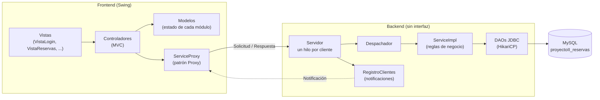
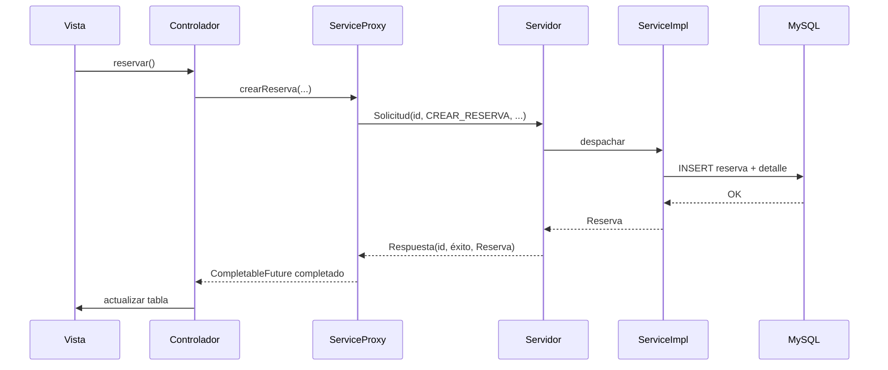
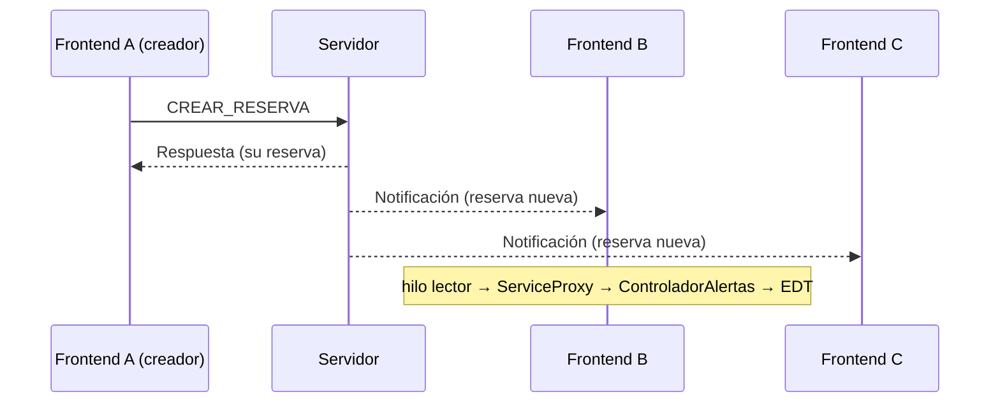

# Guía de defensa — Proyecto #2

Sistema de Reservas de Recursos, versión distribuida:
**Frontend Swing (MVC) ↔ sockets ↔ Backend (Lógica + Datos) → MySQL**.

## 1. Arquitectura

Módulos Maven:

| Módulo | Responsabilidad | Dependencias |
|---|---|---|
| `common` | Modelo, DTO, excepciones, interfaz `Service` y protocolo. | Ninguna. |
| `backend` | Servidor de sockets, lógica, DAOs y MySQL. | `common`, MySQL, HikariCP, BCrypt, SLF4J. |
| `frontend` | Cliente Swing con MVC, proxy y alertas. | `common`, JFreeChart, OpenPDF. |

El frontend **no** declara el driver MySQL, HikariCP ni el módulo `backend`;
`DependenciasFrontendTest` falla si alguien agrega esa dependencia.

## 2. Flujo de una petición

Ejemplo: crear una reserva.

1. La vista captura los datos y llama al controlador (`ControladorReservas.reservar`).
2. El controlador valida localmente y, si todo está bien, invoca
   `servicio.crearReserva(...)`. El servicio es el **proxy**, no el backend.
3. `ServiceProxy` crea una `Solicitud` con un `id` de correlación único y guarda
   un `CompletableFuture` en un mapa concurrente.
4. `ConexionServidor` escribe la solicitud por el socket y el hilo llamador
   espera la respuesta con timeout.
5. El `Servidor` la recibe en el hilo dedicado a ese cliente, `Despachador`
   traduce la operación y llama a `ServiceImpl`.
6. `ServiceImpl` valida las reglas, los DAO ejecutan SQL y la reserva se guarda.
7. El servidor devuelve una `Respuesta` con el **mismo id** de correlación.
8. `LectorMensajes` la entrega al `ServiceProxy`, que completa el futuro
   correcto. El controlador recibe el resultado y actualiza el modelo y la vista.

Si la respuesta es fallida, `TraductorErrores` lanza la excepción de dominio con
el mensaje del backend. Si el socket se cae, `ExcepcionRed` explica el problema
sin mostrar detalles técnicos.

## 3. Flujo de una notificación asincrónica

1. Un frontend crea una reserva.
2. `ManejadorCliente` construye una `Notificacion` con los datos de la reserva.
3. `RegistroClientes` la difunde con un `Executor` a **todas las conexiones
   activas menos la del creador**. La exclusión es por conexión, no por usuario:
   dos ventanas del mismo usuario también se alertan entre sí.
4. Cada `LectorMensajes` recibe la notificación por su propio socket.
5. `ServiceProxy` la reenvía a las `EscuchaNotificaciones` registradas.
6. `ControladorAlertas` la encola y programa **un solo** drenaje en el hilo de
   eventos con `AtomicBoolean`; una ráfaga se agrupa en un refresco.
7. `ModeloAlertas` deduplica por `reservaId` y `PanelAlertas` muestra la fila.
8. **Ver** abre un `JDialog` modal con el detalle; **Descartar** pide
   confirmación y solo quita la alerta del modelo: no se envía nada al backend.

## 4. Dónde está el patrón Proxy

`com.sistema.frontend.proxy.ServiceProxy`:

* Implementa **la misma interfaz `Service`** que el backend, por lo que los
  controladores trabajan contra el contrato y no contra sockets.
* Es el único punto de entrada de red del frontend: resuelve la correlación de
  respuestas, los timeouts, la traducción de errores y las notificaciones.
* Implementa `FuenteNotificaciones` para registrar escuchas y `Reconectable`
  para volver a abrir la conexión si el backend cae.
* No conoce MySQL ni el módulo `backend`: solo `common` y `java.net`.

## 5. Cómo se evita que el Frontend toque la base de datos

1. El POM del frontend no tiene el driver MySQL ni HikariCP, y no depende del
   módulo `backend`.
2. `DependenciasFrontendTest` intenta cargar `com.mysql.cj.jdbc.Driver`,
   `com.zaxxer.hikari.HikariDataSource` y clases del backend; si aparecen,
   la prueba falla.
3. El frontend solo maneja modelo, DTO y la interfaz `Service`.
4. Las credenciales de MySQL y de la IA viven únicamente en
   `backend.properties`, que está en `.gitignore`.
5. Los scripts `sql/schema.sql` y `sql/datos_iniciales.sql` los ejecuta el
   administrador al instalar; en tiempo de ejecución solo el backend abre
   conexiones.

## 6. Concurrencia y errores

* **Dos reservas simultáneas del mismo recurso**: `ReservaDAO.insertar` abre una
  transacción, ejecuta `SELECT ... ORDER BY id FOR UPDATE`, vuelve a comprobar
  el traslape y solo entonces inserta. La segunda petición espera el bloqueo y
  recibe `ConflictoException`; nunca hay doble reserva.
* **Validación en dos niveles**: el frontend avisa antes de enviar y el backend
  repite todas las reglas (vacío, longitud, formato, rangos, fechas,
  duplicados).
* **Errores**: viajan como `Respuesta` con `ErrorRemoto` (código + mensaje de
  dominio). `ErrorRemoto.de` oculta los detalles técnicos y la interfaz los
  muestra en un diálogo, nunca como *stack trace*.
* **Caída del backend**: el proxy falla las peticiones pendientes, avisa al
  `ControladorConexion`, que ofrece reconectar hasta tres veces. Si no vuelve,
  la aplicación cierra ventanas, sesión y socket de forma ordenada.

## 7. Guion de demostración (5–7 minutos)

1. Mostrar la estructura de tres módulos y la regla de dependencias.
2. Arrancar MySQL, el backend y dos frontends.
3. Iniciar sesión con `111/111` (administrador) en uno y `222/222` en el otro.
4. En el administrador: crear una categoría y un recurso; mostrarlos en la tabla.
5. En el funcionario: crear una reserva y ver la alerta en el otro frontend.
6. Abrir **Ver** y **Descartar** en la alerta.
7. Mostrar **Calendarización** y **Actividades** del día/semana.
8. En **Estadísticas**, calcular por rango y exportar el PDF con tabla y gráfico.
9. Intentar una reserva en un horario ya ocupado: diálogo de conflicto claro.
10. Detener el backend y mostrar el diálogo de reconexión; reiniciarlo y
    reconectar.

## 8. Preguntas probables y respuestas breves

**¿Por qué separaron `common`?**
Para que el contrato `Service`, el modelo y el protocolo sean los mismos en
ambos procesos sin que el frontend dependa de la lógica ni de MySQL.

**¿El frontend puede conectarse a MySQL?**
No. No tiene driver ni pool, no depende del backend y una prueba de
arquitectura lo verifica.

**¿Cómo emparejan cada respuesta con su petición?**
Cada `Solicitud` lleva un `id` único; el `ServiceProxy` guarda un
`CompletableFuture` por id y lo completa cuando llega la `Respuesta` con ese id.

**¿Qué pasa si dos usuarios reservan lo mismo al mismo tiempo?**
La transacción con `SELECT ... FOR UPDATE` serializa la comprobación; una
petición gana y la otra recibe un conflicto. Está probado con dos instancias
simultáneas en `ServiceImplIT`.

**¿Cómo garantizan que solo los demás reciban la alerta?**
`RegistroClientes` excluye la conexión que originó la reserva, no el usuario.
La respuesta va por el mismo socket que la solicitud.

**¿Qué pasa si llegan muchas notificaciones juntas?**
`ControladorAlertas` las encola y programa un único refresco en el EDT; no
bloquea el hilo lector ni repinta una vez por mensaje.

**¿Por qué la IA está en el backend?**
Para que `llm.api.key` nunca viaje al cliente. El frontend solo envía la frase y
recibe una propuesta de reserva.

**¿Cómo se valida el teléfono?**
Con la expresión `^\+?[0-9]{7,15}$` en el frontend y en el modelo `Funcionario`
del backend; el backend siempre vuelve a validar.

**¿Qué pasa si el backend se cae mientras hay una petición?**
El futuro pendiente se completa con `ExcepcionRed`; el controlador muestra el
error y la aplicación ofrece reconectar o cerrar ordenadamente.

**¿Por qué serialización Java y no JSON?**
Porque `ObjectOutputStream` conserva el polimorfismo del modelo y el protocolo
es interno. Se mitiga el riesgo con un filtro de deserialización que solo admite
`com.sistema.common.*` y tipos básicos.

**¿Cómo generan los identificadores?**
Las categorías y reservas usan un consecutivo con formato (`CAT-000001`,
`RES-000001`) calculado en el backend; funcionarios y recursos usan el
identificador que escribe el administrador.

**¿Qué pasa si MySQL no está disponible?**
El backend informa un error de acceso a datos y el frontend muestra el mensaje;
las pruebas de integración se omiten para no romper la compilación de quien solo
trabaja en el frontend.

**¿Cómo se cierra la aplicación?**
`ControladorAplicacion` quita las escuchas, cierra la ventana y la sesión,
cierra el socket y termina el proceso. El `close()` del proxy es idempotente.

**¿Qué mejorarían con más tiempo?**
Un protocolo JSON con validación de esquema, reconexión automática con
*backoff*, y separar la generación de identificadores en una secuencia atómica
de base de datos.

## 9. Checklist final contra la rúbrica

- [x] Backend sin interfaz de usuario y puerto configurable.
- [x] Solo el backend se conecta a MySQL; el frontend no tiene JDBC.
- [x] Frontend y backend pueden correr en máquinas separadas (host/puerto).
- [x] Varios frontends conectados a un solo backend.
- [x] Hilos en el servidor (uno por cliente) y en el cliente (hilo lector).
- [x] Patrón Proxy que implementa la misma interfaz `Service`.
- [x] MVC respetado en el frontend.
- [x] Login y cambio de clave con BCrypt.
- [x] Reservas, funcionarios, categorías, recursos, calendarización y actividades.
- [x] Estadísticas con tabla, gráfico y consultas agregadas en SQL.
- [x] Notificación asincrónica a los demás frontends al crear una reserva.
- [x] Área de alertas a la derecha, independiente de las pestañas.
- [x] Ver alerta con detalle y descartar con confirmación, sin llamar al backend.
- [x] Validación de datos y errores en diálogos, sin *stack traces*.
- [x] Pruebas JUnit Jupiter: unitarias (`*Test`) e integración (`*IT`).
- [x] Script de base de datos incluido.
- [x] Repositorio GitHub actualizado con commits por fase.
- [x] Un único archivo comprimido con fuentes y scripts, sin `target/`,
      `.idea/` ni credenciales.
