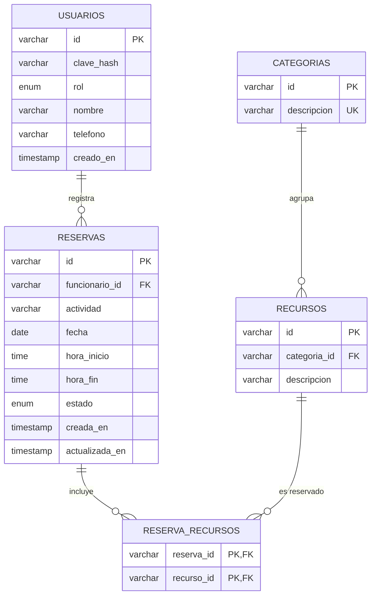

# Base de datos — `proyectoII_reservas`

Motor: **MySQL 8.4 LTS** · Juego de caracteres: `utf8mb4` · Colación: `utf8mb4_0900_ai_ci`.

## Diagrama entidad-relación



## Crear la base desde cero

```bash
mysql -u root -p --default-character-set=utf8mb4 < sql/schema.sql
mysql -u root -p --default-character-set=utf8mb4 < sql/datos_iniciales.sql
```

> `schema.sql` elimina la base `proyectoII_reservas` si existe. Es intencional:
> permite ejecutar el script repetidamente y dejar la base siempre limpia.
> `datos_iniciales.sql` debe ejecutarse siempre después de `schema.sql`.

## Usuarios de prueba

| Identificador | Clave | Rol | Nombre |
|---|---|---|---|
| `111` | `111` | Administrador | — |
| `222` | `222` | Funcionario | Ana Pérez |
| `333` | `333` | Funcionario | Luis Rojas |
| `444` | `444` | Funcionario | Pedro Pérez |

Las claves están guardadas como hash **BCrypt** (factor 10), nunca en texto plano.
El backend las verifica con `BCrypt.checkpw`, por lo que el texto de la tabla no
sirve para iniciar sesión directamente.

## Decisiones de diseño

* **Una sola tabla `usuarios`** para administradores y funcionarios, distinguidos
  por `rol`. Un administrador no tiene nombre ni teléfono; un funcionario sí.
  Esto se garantiza con la restricción `chk_usuarios_datos_funcionario`.
* **Identificadores de texto** (`CAT-000001`, `RES-000001`, `1001`, `222`), igual
  que el Proyecto #1, para conservar los datos y los mensajes existentes.
  El backend genera los nuevos identificadores de categoría y reserva.
* **`ON UPDATE CASCADE`** en las referencias permite renombrar el identificador
  de una categoría o recurso propagando el cambio, como hacía el Proyecto #1.
* **`ON DELETE RESTRICT`** reproduce las reglas del Proyecto #1: no se puede
  borrar una categoría con recursos, un recurso usado en una reserva ni un
  funcionario con reservas.
* **`ON DELETE CASCADE`** solo en `reserva_recursos`: si se elimina una reserva,
  su detalle se elimina con ella.
* **Traslapes de horario**: MySQL no permite expresar esta regla como
  *constraint*. Se valida en el backend dentro de una transacción con
  `SELECT ... FOR UPDATE`, de modo que dos usuarios no puedan reservar el mismo
  recurso en el mismo horario.
* **Estadísticas**: la base solo guarda datos; los agregados (`COUNT`,
  `GROUP BY`, rangos de fecha) se ejecutan en el backend.
* **Fechas de ejemplo relativas** (`CURDATE() ± N días`): así las estadísticas y
  la calendarización siempre muestran información reciente al instalar.

## Consultas de referencia para las estadísticas

Recursos usados por categoría (solo reservas activas):

```sql
SELECT c.descripcion AS categoria, COUNT(DISTINCT rr.reserva_id) AS usos
FROM categorias c
JOIN recursos rec ON rec.categoria_id = c.id
JOIN reserva_recursos rr ON rr.recurso_id = rec.id
JOIN reservas r ON r.id = rr.reserva_id AND r.estado = 'ACTIVA'
WHERE r.fecha BETWEEN ? AND ?
GROUP BY c.id, c.descripcion
ORDER BY usos DESC;
```

Actividades realizadas por semana (agrupadas por el lunes de cada semana):

```sql
SELECT DATE_SUB(r.fecha, INTERVAL WEEKDAY(r.fecha) DAY) AS lunes,
       COUNT(*) AS actividades
FROM reservas r
WHERE r.estado = 'ACTIVA' AND r.fecha BETWEEN ? AND ?
GROUP BY lunes
ORDER BY lunes;
```

Disponibilidad de un recurso en un rango de horas:

```sql
SELECT r.id, r.actividad, r.hora_inicio, r.hora_fin
FROM reservas r
JOIN reserva_recursos rr ON rr.reserva_id = r.id
WHERE rr.recurso_id = ?
  AND r.estado = 'ACTIVA'
  AND r.fecha = ?
  AND r.hora_inicio < ?
  AND r.hora_fin > ?;
```

## Verificación realizada

Sobre una instalación limpia de MySQL 8.4.13 se comprobó:

* Los dos scripts se ejecutan sin errores.
* Quedan 4 usuarios, 4 categorías, 8 recursos, 7 reservas y 17 detalles.
* Las consultas agregadas devuelven números consistentes con los datos.
* Se rechazan (con el error esperado) 10 casos inválidos: funcionario sin
  nombre/teléfono, teléfono con formato incorrecto, administrador con nombre,
  hora de fin anterior a la de inicio, borrado de categoría/recurso en uso,
  descripción de categoría duplicada, recurso con categoría inexistente,
  detalle duplicado y reserva con funcionario inexistente.
